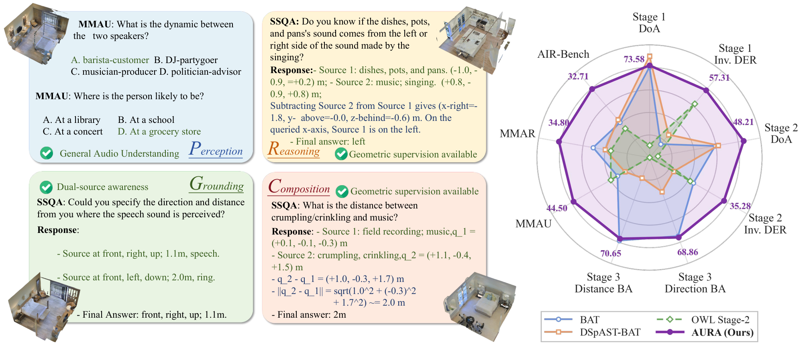

# AURA: Auditory Spatial Intelligence via a Unified Representation from a General-Audio Encoder through Complete Alignment

<p align="center">
  <a href="https://arxiv.org/pdf/2611.13687"></a>
  &nbsp;&nbsp;&nbsp;&nbsp;
  <a href="https://huggingface.co/BryanHan/AURA"></a>
</p>

<p align="center">
  
</p>

## Abstract

Answering spatial questions about multi-source scenes requires a model both to identify each sound and to locate it. Existing spatial audio-language models obtain spatial information from a dedicated encoder, which separates spatial and semantic processing into distinct feature spaces. We study whether a general-audio codec trained without spatial supervision can serve both purposes. A controlled layer-wise analysis shows that the frozen codec retains spatial information, with lateral cues carried by the difference between the two ear channels. This information, however, is not readily accessible: in dual-source scenes, a model trained on these features predicts left/right at chance and, on the remaining axes, assigns the detected direction to the queried and the non-queried source equally often. We attribute this failure to an audio–text information asymmetry, in which the audio contains both sources while the answer describes only the queried one. A controlled 2×2 experiment shows that either completing the scene description or exposing the inter-channel difference lifts left/right accuracy above chance, whereas binding directions to the queried source requires both. Building on these findings, AURA keeps the codec and the language model frozen and exceeds the strongest dedicated system on SpatialSoundQA by 10.31 points in dual-source direction accuracy, with about 40% of its trainable parameters.

## Environment

- Python 3.10
- CUDA 13.0
- torch 2.13.0 / torchaudio 2.11.0
- transformers 4.51.0
- peft 0.20.0
- accelerate 1.14.0

```bash
conda create -n aura python=3.10 -y && conda activate aura
pip install -r requirements.txt
pip install -r requirements-encode.txt     # only needed for data_preparation/encode_audio.py and wav inference
```

## Data preparation

**1. Download SpatialSoundQA.** Download the SpatialSoundQA dataset released with
[BAT](https://github.com/zszheng147/Spatial-AST) and place it at `data/SpatialSoundQA`:

```
data/SpatialSoundQA/
├── closed-end/
│   ├── stage1-clsdoa/      train.json, eval-stage1-*.json
│   ├── stage2-single/      train.json, eval-stage2-*.json
│   └── stage3-mixup/       train.json, eval-stage3-*.json
├── AudioSet/
│   ├── balanced_train/audio/*.wav
│   ├── eval/audio/*.wav
│   └── metadata/
└── mp3d_reverb/binaural/<scene>/
    ├── <scene>.json        source / listener positions
    └── *.npy               binaural room impulse responses (BRIRs)
```

**2. Binaural synthesis and RVQ encoding.** Download the models (Qwen3-8B and X-Codec), then
convolve every AudioSet clip with its BRIR, mix two-source scenes, and encode each ear with the
frozen X-Codec:

```bash
bash setup_models.sh        # models/Qwen3-8B, models/xcodec (+ codebooks.pt), third_party/xcodec
python data_preparation/encode_audio.py --ssqa data/SpatialSoundQA --codes_dir data/codes
```

**3. Scene and geometric supervision.** Build the training and evaluation manifests:

```bash
python data_preparation/build_manifests.py --ssqa data/SpatialSoundQA --out data/manifests
```

## Training & Evaluation

**Training.** Train the four curriculum stages in order:

```bash
bash train.sh c1_align      # projector alignment
bash train.sh c1_joint      # stage 1  -> runs/c1_joint/final
bash train.sh c2_joint      # stage 2  -> runs/c2_joint/final
bash train.sh c3_joint      # stage 3  -> runs/c3_joint/final
```

**Evaluation.** Download the released AURA checkpoints, then evaluate:

```bash
huggingface-cli download BryanHan/AURA --local-dir checkpoints

bash eval.sh checkpoints/stage3_c3 all       # or stage1 / stage2 / stage3
```

## Inference

```bash
huggingface-cli download BryanHan/AURA --local-dir checkpoints
python examples/make_example.py --ssqa data/SpatialSoundQA      # renders examples/example.wav
python inference.py --ckpt checkpoints/stage3_c3 --audio examples/example.wav \
  --question "Does the sound from the hammer emanate from the front or behind side of the music's sound?"
```

## Citation

```bibtex
@misc{han2026auraauditoryspatialintelligence,
      title={AURA: Auditory Spatial Intelligence via a Unified Representation from a General-Audio Encoder through Complete Alignment}, 
      author={Boyan Han and Xiaoyan Wang and Zhe Sun and Ziqi Wang and Yujun Cai and Hongli Cao and Yiwei Wang and Ming-Hsuan Yang and Liang An},
      year={2026},
      eprint={2611.13687},
      archivePrefix={arXiv},
      primaryClass={cs.SD},
      url={https://arxiv.org/abs/2611.13687}, 
}
```

## Acknowledgements

AURA builds on [X-Codec](https://github.com/zhenye234/xcodec), [Qwen3](https://huggingface.co/Qwen/Qwen3-8B)
and the SpatialSoundQA data released with [BAT](https://github.com/zszheng147/Spatial-AST).
Please follow their licenses; AudioSet clips and Matterport3D-derived BRIRs carry their own terms.
